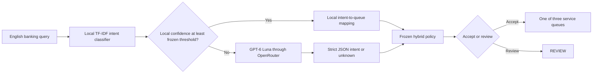

# Product Documentation

## Product purpose

The prototype recommends one operational service queue for a short English banking-support query or returns `REVIEW` when the route should not be automated. It tests whether selective use of a rented language model can reduce harmful routing errors without creating an excessive human-review workload.

## Persona and decision

The primary persona is Mei, a contact-centre queue manager who reviews incoming messages before a shift. She needs a queue recommendation or a review flag. She does not need a generated customer answer.

The prototype supports one decision: which of three specialist queues should receive the query, or whether a human should review it first.

## Input

- One short English query from the BANKING77 domain.
- The experiment uses only public, cleaned BANKING77 text.
- The system assumes one main intent per message.
- Live customer identifiers and production bank data are outside the prototype scope.

## Output

The final decision is one of:

- `disputes_and_corrections`
- `failed_and_pending_transactions`
- `fees_and_pricing`
- `REVIEW`

The evaluation output also records the predicted fine-grained intent, local and rented-model confidence, whether review occurred, and which decision path produced the result.

## High-level architecture

The selected local-confidence threshold is `0.15785826849376272`. Below it, the policy requests a Luna classification. The query is reviewed when the local and Luna queue predictions disagree, when Luna abstains, or when another frozen review condition applies.

## Owned and external components

| Component | Ownership | Role |
| --- | --- | --- |
| BANKING77 preparation and cleaning | Built in this repository | Download, normalise, audit, quarantine, and create deterministic splits |
| Intent and queue taxonomy | Built in this repository | Define the 12 allowed intents and deterministic three-queue mapping |
| TF-IDF logistic-regression model | Built in this repository | Provide the default local intent prediction and confidence |
| Evaluation and policy selection | Built in this repository | Calculate metrics, search thresholds on validation, freeze the policy, and evaluate test once |
| GPT-6 Luna | External intelligence | Classify only low-confidence public queries using a strict JSON schema |
| OpenRouter | External service | Provide the OpenAI-compatible gateway used for the rented-model calls |

The system has no retrieval-augmented generation because it has no private knowledge base. It has no autonomous agent or tools because routing is a bounded classification decision.

## Target and reached metrics

| Metric | Target | Held-out test result |
| --- | ---: | ---: |
| Harmful automatic wrong-queue rate | At most 5% | 4.17% (10 of 240) |
| Human-review rate | At most 10% | 3.33% (8 of 240) |
| Automatic coverage | Reported, no minimum | 96.67% (232 of 240) |
| Selective queue accuracy | Reported, no minimum | 95.69% (222 of 232 automatic decisions) |
| Intent accuracy | Reported, no minimum | 89.17% |
| OpenRouter call rate | Minimise after both constraints | 3.75% (9 of 240) |

The local TF-IDF model achieved 95.0% queue accuracy and a 5.0% harmful wrong-queue rate without API use. The hybrid gain is modest: it reduced the harmful rate by 0.83 percentage points while adding provider, integration, privacy, and review dependencies.

## Scope and responsible use

The prototype does not answer customers, execute transactions, infer fraud, provide financial advice, or approve an automatic production deployment. Both models can agree confidently on the wrong queue, so confidence alone cannot detect every failure.

A real deployment would require approved de-identification, access and retention controls, data-residency and vendor review, service-level ownership for the review queue, and continuing labelled audits. The recommended next step is a human-controlled shadow trial with representative bank traffic and the local model retained as the fallback.
